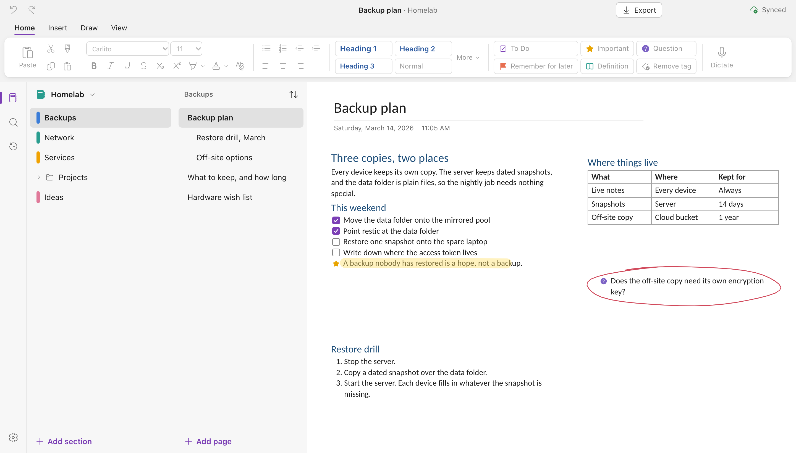
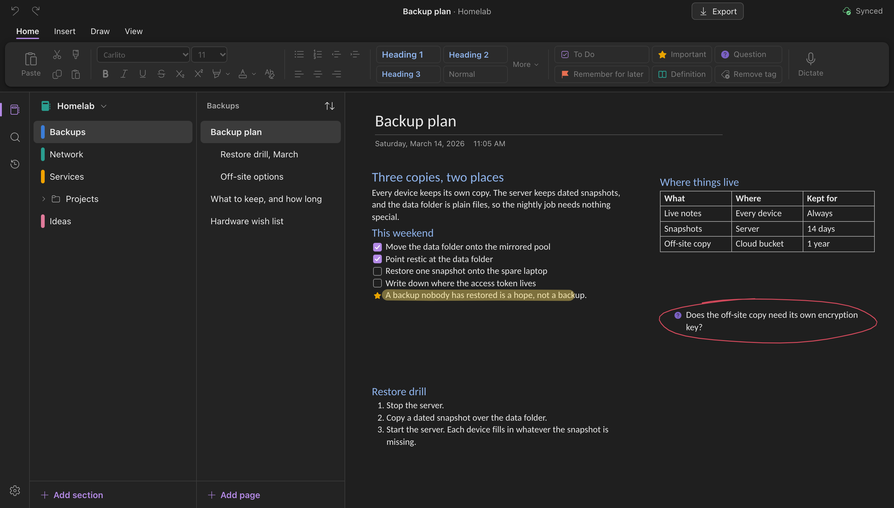
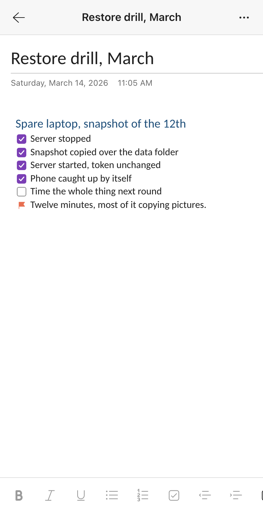

# Looseleaf

[](https://github.com/trapp01/Looseleaf/actions/workflows/ci.yml)
[](LICENSE)

A free, open-source notebook app laid out like OneNote, that you host yourself.



- **Notebooks, sections, pages** and a freeform canvas where you click anywhere
  and type.
- **Your server.** Run one container on your homelab; every device syncs to it.
  No cloud account.
- **Works offline.** Every device keeps a full copy of your notes. Two devices
  can edit the same page while both are offline and nothing is overwritten when
  they reconnect.
- **Bring your notes.** Imports OneNote `.one` section files and whole notebook
  folders.
- **Take your notes.** Export a page, a section, a notebook or everything to
  HTML, Markdown, plain text, JSON or PDF.
- **Web, desktop, phone.** One web client that also runs as a desktop app and
  fits a phone screen. Native mobile apps are planned.

Looseleaf is an early release. [docs/onenote-parity.md](docs/onenote-parity.md)
lists every OneNote feature and whether it is built yet. Keep your own backups
of anything that matters.

| Dark mode | Phone |
| --- | --- |
|  |  |

On a phone the layout is for reading and typing: drawing is desktop-only, and a
text container wider than the screen scrolls sideways.

## Run the server

```sh
git clone https://github.com/trapp01/Looseleaf.git && cd Looseleaf
docker compose up -d
docker compose logs looseleaf   # prints the access token on first start
```

Open `http://<your-server>:8421` and enter the access token. Notes live in the
`data` volume as plain files; back that folder up however you back up anything
else. The server also keeps dated snapshots of it (14 by default). Settings and
the restore steps are in [packages/server/README.md](packages/server/README.md).

Over plain `http` the browser keeps your edits while the server is unreachable,
but it cannot reopen the page with no network. For that, serve it over HTTPS
(`tailscale serve` does it in one command) or use the desktop app.

## Desktop app

```sh
pnpm install
pnpm --filter @looseleaf/web build
pnpm --filter @looseleaf/desktop package
```

The app is in `packages/desktop/out`. On first run, give it your server's
address and access token, or keep notes on that computer only and connect
later. Builds are unsigned; see
[packages/desktop/README.md](packages/desktop/README.md).

## Import from OneNote

Notebook menu → **Import from OneNote**. The desktop app finds the backups
OneNote keeps on the same computer; in a browser, choose the folder that holds
your `.one` files. Importing only reads those files. What is and is not carried
over is in [packages/onenote/README.md](packages/onenote/README.md).

## Develop

Needs Node 22 and pnpm.

```sh
pnpm install
pnpm dev          # server on :8421 and the web client with hot reload
pnpm test
pnpm typecheck
```

Start with [docs/architecture.md](docs/architecture.md) and
[docs/glossary.md](docs/glossary.md).

## Contributing

[CONTRIBUTING.md](CONTRIBUTING.md) has the setup and the rules.
[docs/onenote-parity.md](docs/onenote-parity.md) is the list of what is left to
build. Security problems go through [SECURITY.md](SECURITY.md).

## How it relates to OneNote

Looseleaf is an independent project. It is not affiliated with or endorsed by
Microsoft. It contains no OneNote code, artwork or fonts. The `.one` reader is
written from the file-format specifications Microsoft publishes
([MS-ONESTORE], [MS-ONE]). The interface icons are Microsoft's Fluent UI System
Icons, which are MIT-licensed. OneNote is a trademark of Microsoft Corporation.

Third-party fonts and icons are credited in
[THIRD-PARTY-NOTICES.txt](packages/web/public/THIRD-PARTY-NOTICES.txt), which
ships inside every build.

## Licence

[Mozilla Public License 2.0](LICENSE).

[MS-ONESTORE]: https://learn.microsoft.com/openspecs/office_file_formats/ms-onestore
[MS-ONE]: https://learn.microsoft.com/openspecs/office_file_formats/ms-one
